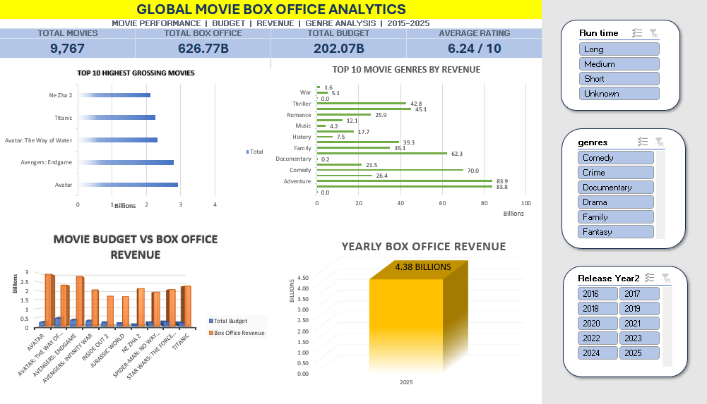

# 🎬 Global Movie Box Office Analytics Dashboard

An interactive **Microsoft Excel dashboard** analyzing global movie box office performance, budgets, genres, ratings, and yearly revenue trends.

## 📊 Dashboard Preview

## 📌 Project Overview

This project analyzes movie industry data and presents key insights through an interactive Excel dashboard. The dashboard helps explore movie revenue performance, compare budgets with box office earnings, and understand genre and yearly trends.

## 📈 Key Performance Indicators

| Metric | Value |
|---|---:|
| 🎬 Total Movies | 9,767 |
| 💰 Total Box Office | 626.77B |
| 🎞️ Total Budget | 202.07B |
| ⭐ Average Rating | 6.24 / 10 |

## 📊 Dashboard Features

- **Top 10 Highest-Grossing Movies** – Identify movies with the highest box office revenue.
- **Genre Revenue Analysis** – Compare revenue generated across different movie genres.
- **Budget vs. Box Office Revenue** – Analyze movie budgets against their box office earnings.
- **Yearly Box Office Revenue** – Explore revenue trends by release year.
- **Interactive Filters** – Filter data using Runtime, Genre, and Release Year slicers.

## 🛠️ Tools & Skills

- Microsoft Excel
- Data Cleaning
- Data Analysis
- PivotTables
- PivotCharts
- Slicers
- Data Visualization
- Interactive Dashboard Design

## 🎯 Project Objectives

- Analyze global movie box office performance.
- Identify top-performing movies.
- Compare movie budgets and revenue.
- Explore genre-wise revenue distribution.
- Analyze yearly movie revenue trends.
- Transform raw data into meaningful visual insights.

## 📁 Project Files

- `Global Movie Box Office Analytics.xlsx` – Interactive Excel dashboard and analysis.
- `Dashboard.png` – Dashboard preview image.

## 💡 Key Learning

This project helped me strengthen my Excel data analysis skills, practice creating interactive dashboards, and learn how to present data insights through visualizations.

---

**Created by Nehal Jaiswal**  
📚 Aspiring Data Analyst | Learning Data Analytics

